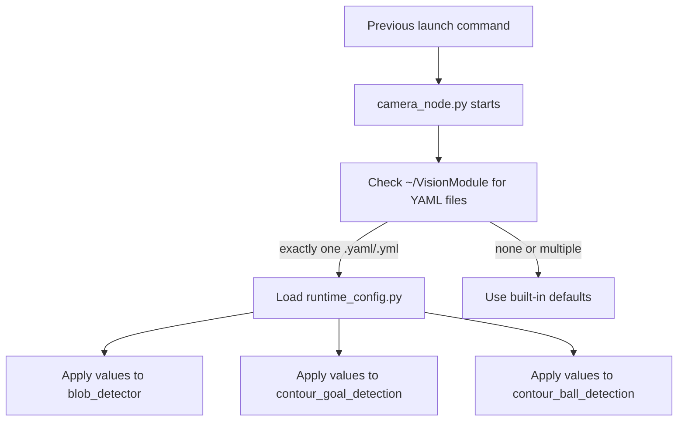

# YAML Loader EERD

This note describes the intended YAML-loader behavior for the Python `blimp_vision` package.

The design goal is simple:

- keep previous launch commands unchanged
- keep previous launch arguments unchanged
- add one implicit YAML-loading path on top
- preserve old built-in detector behavior when no YAML is present

## Behavior Summary

## Existing Behavior Preserved

- No new required launch argument was added.
- Existing launch files can still be used as before.
- Existing launch argument names can still be used as before.
- If no tuning YAML is found, the node keeps the previous built-in detector defaults.

## YAML Activation Rule

The loader only auto-activates from one expected location:

- `~/VisionModule`

The node checks that folder for tuning files.

- If there is exactly one `.yaml` or `.yml` file, it is loaded.
- If there are zero YAML files, defaults are used.
- If there are multiple YAML files, defaults are used.

This keeps startup predictable and avoids accidentally loading an unrelated YAML from some other directory.

## What Gets Configured

The loaded values are applied consistently through one central loader path in `camera_node.py`.

Current targets:

- `blob_detector.py`
- `contour_goal_detection.py`
- `contour_ball_detection.py`

That means ball and goal HSV values come from the same loaded config source instead of being split across separate hardcoded paths.

## Intent

This is meant to be an additive configuration layer, not a redesign of the vision pipeline.

The intended operator experience is:

1. Use the same old launch command.
2. Put one tuning YAML in `~/VisionModule`.
3. The node picks it up automatically.
4. If the YAML is absent, the old behavior still works.
